<div align="center">

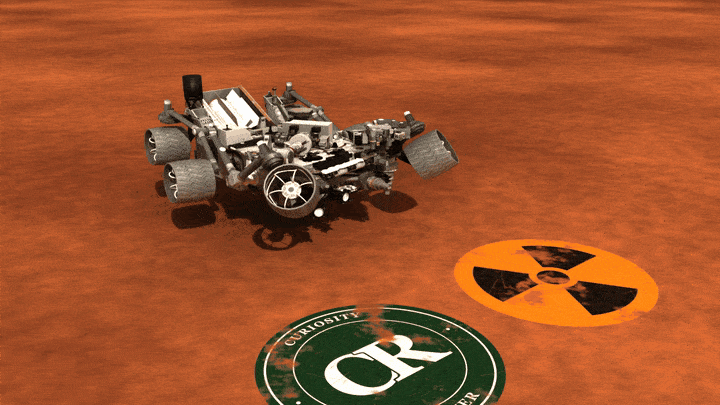

# Curiosity Rover · ROS 2 Description

**NASA's Mars Science Laboratory rover, turned from NASA's 3D model into a URDF that is ready for ROS 2 integration.**
RViz, Gazebo Harmonic, `ros2_control`, seven mission cameras, an RGB-D camera, lidar and IMU, in one Docker image
that runs on macOS, Windows and Linux.


[**3D model (interactive)**](docs/model/curiosity_rover.stl) ·
[Animated GLB](docs/model/curiosity_rover.glb) ·
[Blender animation (MP4)](docs/media/blender_rover.mp4) ·
[Original Blender file](docs/model/curiosity_rover.blend) ·
[Demo video (MP4)](docs/media/demo.mp4) ·
[Quick start](#quick-start-docker)

</div>

---

## Contents

- [Demo](#demo)
- [Quick start (Docker)](#quick-start-docker)
- [Drive the rover](#drive-the-rover)
- [What's inside](#whats-inside)
- [From Blender to URDF](#from-blender-to-urdf)
- [Robot model reference](#robot-model-reference)
- [Native install (Ubuntu 24.04)](#native-install-ubuntu-2404)
- [Tests](#tests)
- [Roadmap](#roadmap)
- [Credits](#credits)
- [License](#license)

## Demo

One full drive, sped up: the mast looks around, the rover drives forward, turns on the spot and arcs left on a
4 m radius. Four live views of the same simulation, side by side:

- **Top:** RViz (robot model, lidar and the depth point cloud) · Gazebo Harmonic (the camera follows the rover on Mars)
- **Bottom:** RGB camera (`/depth_camera/image_raw`) · depth camera (`/depth_camera/depth/image_raw`, colourised 0–15 m)

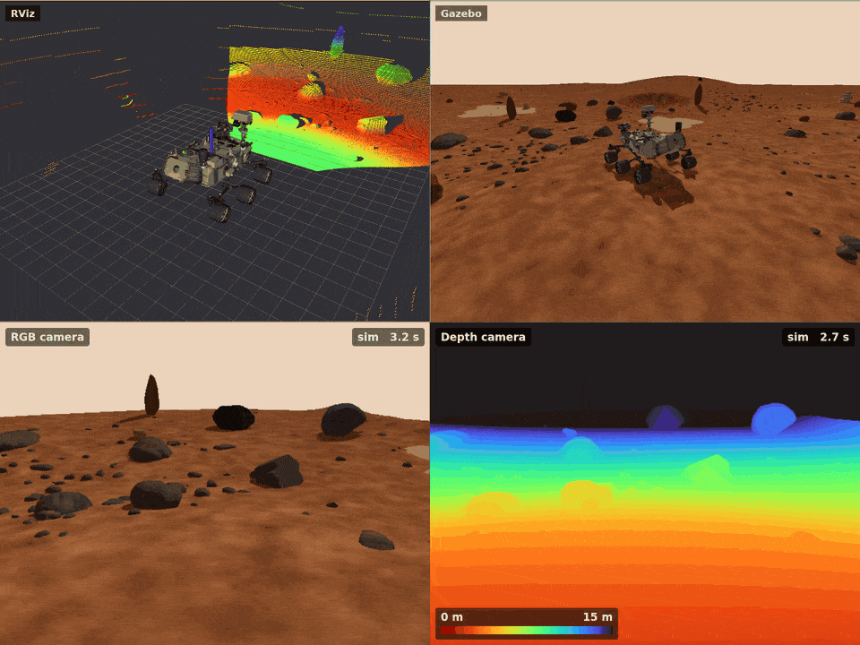

The GIFs play the 36 s drive in 10 s. Full quality, 1920 × 1440, 20 s: [docs/media/demo.mp4](docs/media/demo.mp4).
Run it yourself with
`docker compose up demo` and open <http://localhost:6080>.

### Each view

<table>
<tr>
<td width="50%">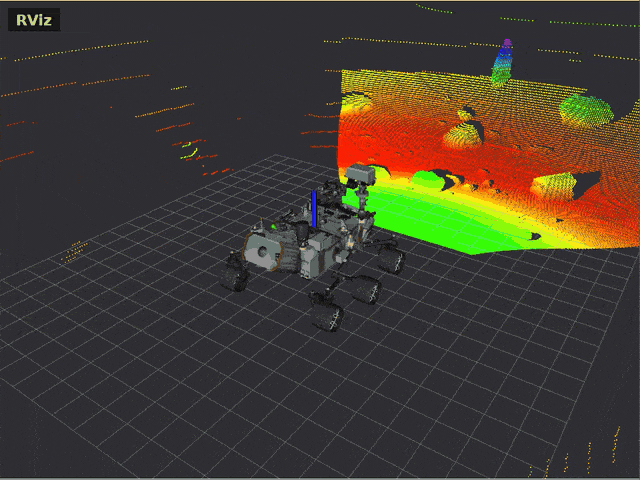<br/><b>RViz</b>: robot model, lidar, depth cloud</td>
<td width="50%">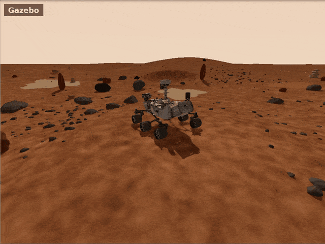<br/><b>Gazebo</b>: Mars test site</td>
</tr>
<tr>
<td>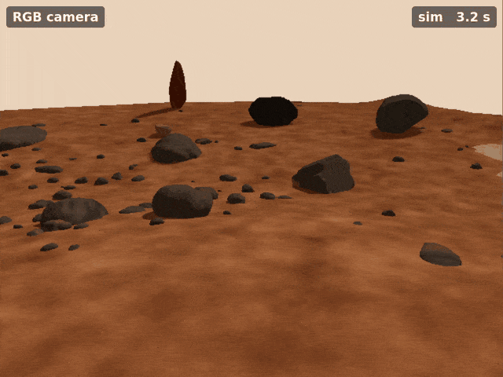<br/><b>RGB camera</b> on the mast head</td>
<td>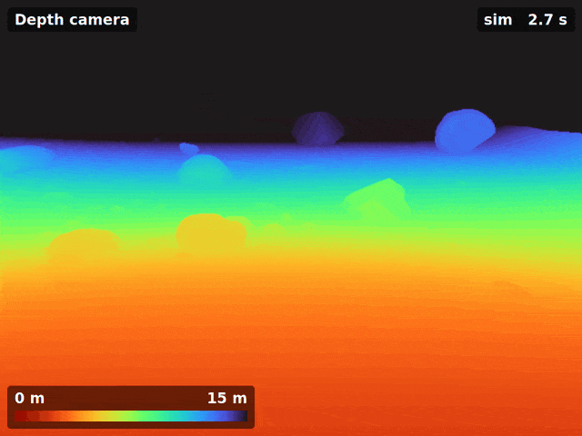<br/><b>Depth camera</b>: near red, far blue</td>
</tr>
</table>

### Screenshots

<table>
<tr>
<td width="50%">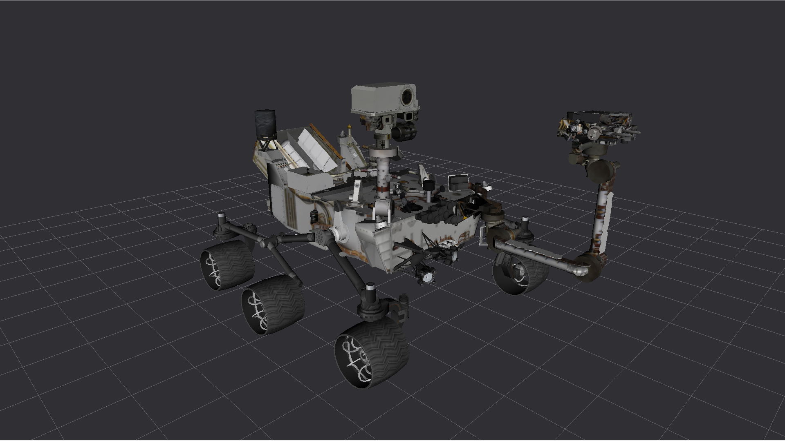<br/><b>Robot model</b> in RViz, every joint at zero</td>
<td width="50%">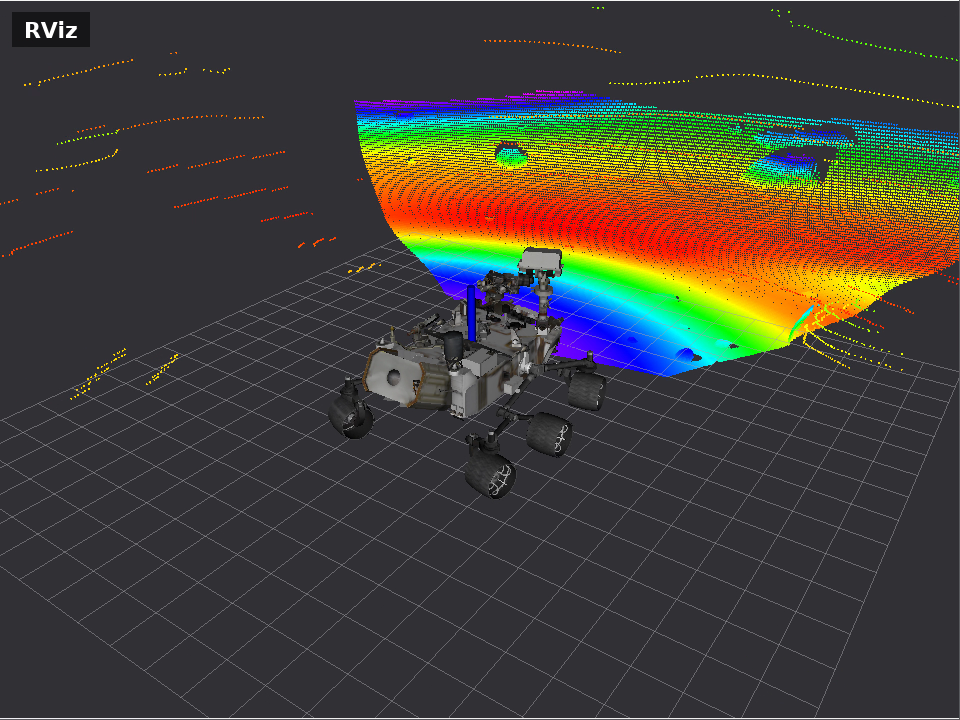<br/><b>RViz</b> in the simulation</td>
</tr>
<tr>
<td>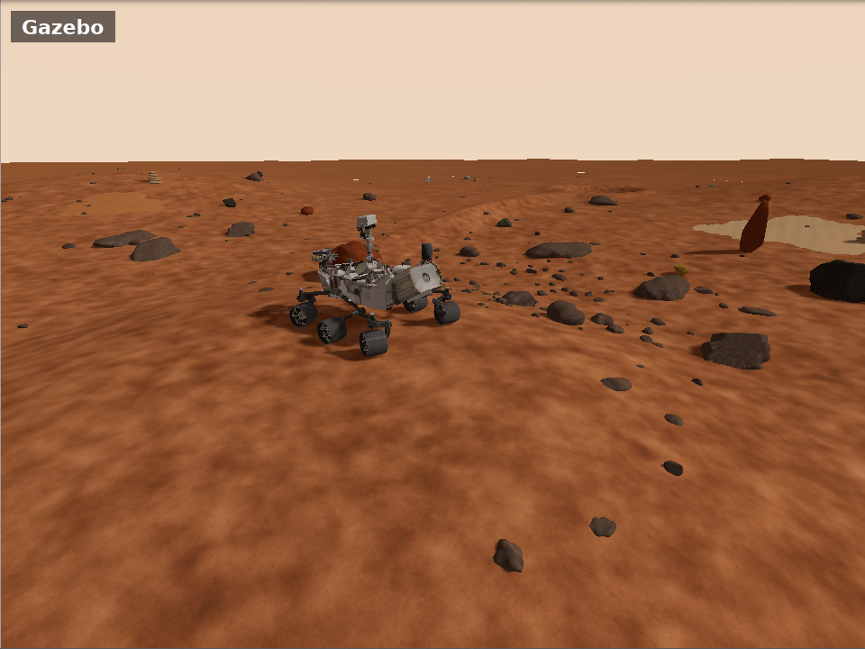<br/><b>Gazebo</b></td>
<td>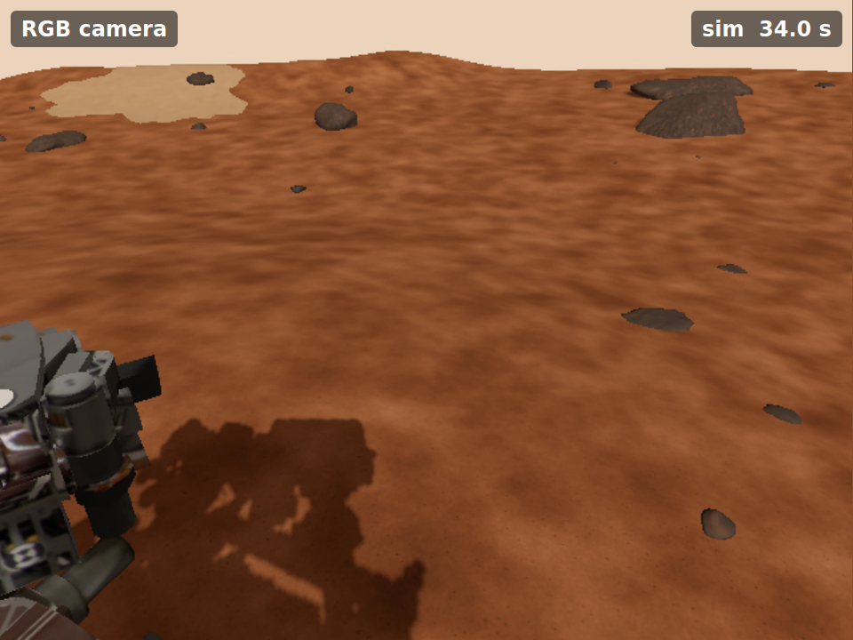<br/><b>RGB camera</b></td>
</tr>
<tr>
<td>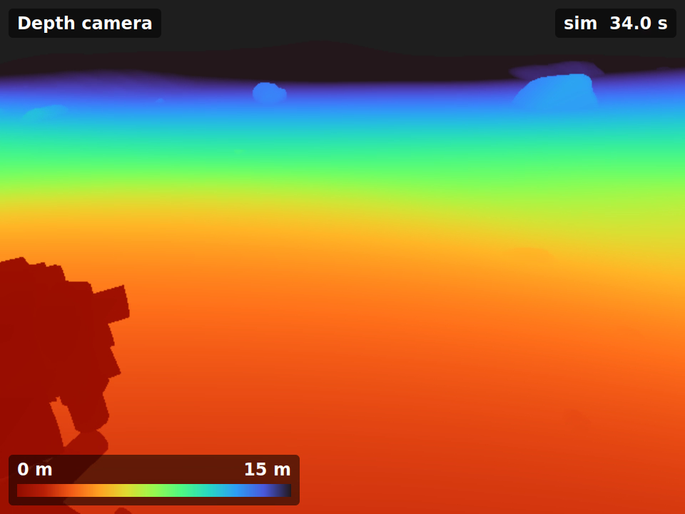<br/><b>Depth camera</b></td>
<td>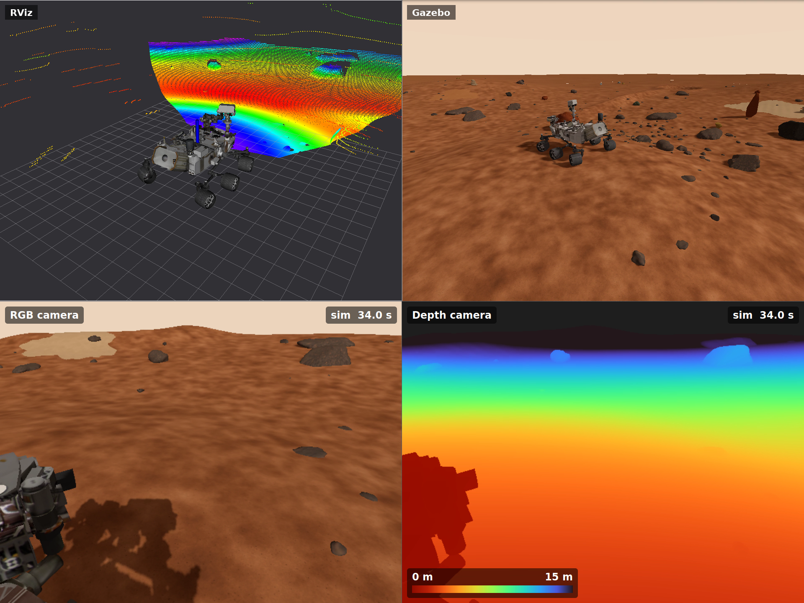<br/><b>The demo desktop</b></td>
</tr>
</table>

### Every joint, in RViz

Rocker-bogie, steering, mast, high-gain antenna, arm and covers moving through their ranges.
`docker compose up rviz` gives you the same model with a slider per joint.

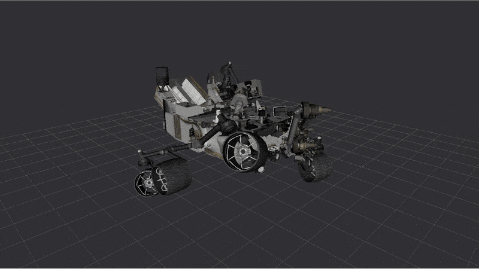

All media was recorded inside the Docker image on an Apple Silicon Mac (software rendering, no GPU). The header
animation is rendered from the NASA Blender model with EEVEE.

## Quick start (Docker)

One image for every platform: ROS 2 Jazzy, Gazebo Harmonic, RViz and a small desktop you open **in your
browser**, so you don't need an X server on macOS or Windows. The image builds for `amd64` (Intel/AMD) and `arm64`
(Apple Silicon, ARM boards).

### 1. Install Docker

| OS | Install |
|---|---|
| **macOS** (Intel or Apple Silicon) | [Docker Desktop](https://docs.docker.com/desktop/setup/install/mac-install/). Give it at least 4 CPUs and 6 GB RAM (Settings → Resources). |
| **Windows 10/11** | [Docker Desktop](https://docs.docker.com/desktop/setup/install/windows-install/) with the WSL 2 backend. |
| **Linux** | [Docker Engine](https://docs.docker.com/engine/install/) + the Compose plugin. |

### 2. Build and run

```bash
git clone <this repo> curiosity_rover
cd curiosity_rover
docker compose build            # once: about 10 min, ~6.5 GB image
docker compose up demo          # the four-panel demo
```

Then open **<http://localhost:6080>**. The windows appear after 30–60 s without a GPU.
Stop with `Ctrl+C` (or `docker compose down`).

| command | what it starts |
|---|---|
| `docker compose up demo` | the four-panel demo: RViz, Gazebo following the rover, RGB and depth camera, the rover driving in a loop |
| `docker compose up gazebo` | Gazebo Harmonic on the Mars terrain with every sensor, controllers, bridge, self filter, RViz |
| `docker compose up gazebo-flat` | the same on flat ground (precise driving tests) |
| `docker compose up rviz` | RViz with a slider per joint, no simulator |
| `docker compose run --rm shell` | a bash shell with ROS 2 sourced (desktop on :6080 too) |
| `docker compose run --rm test` | headless acceptance test, 22 checks |

Run one GUI service at a time; they share port 6080. To send commands while the simulation runs, open a second
terminal: `docker compose exec gazebo bash` (or `exec demo bash`).

**Live editing:** `curiosity_description/`, `tests/`, `demo/` and `examples/` are mounted into the container. Edit the URDF,
launch files or configs on your machine and restart the service. Rebuild the image only when dependencies change.

### Linux: native windows and the GPU

On Linux you can skip the browser and use your own X display and GPU:

```bash
xhost +local:docker
docker compose -f docker-compose.yml -f docker-compose.gpu.yml up gazebo
```

Intel and AMD GPUs work through `/dev/dri`. For NVIDIA, install the
[NVIDIA Container Toolkit](https://docs.nvidia.com/datacenter/cloud-native/container-toolkit/latest/install-guide.html)
and uncomment the `deploy` block in `docker-compose.gpu.yml`.

### Performance

Docker Desktop on macOS and Windows has no GPU passthrough, so Gazebo renders on the CPU (Mesa llvmpipe).
Measured on an Apple M-series Mac with 8 cores given to Docker:

| setup | real-time factor |
|---|---|
| `gazebo`: every sensor (7 mission cameras, RGB-D, lidar), Gazebo + RViz windows | ~8 % |
| headless, every sensor | ~9 % |
| `demo`: mission cameras off (`use_cameras:=false`), four windows | ~24 % |
| headless, mission cameras off | ~38 % |

Everything runs on simulated time, so it all works at any speed, just slower. For real-time work use Linux with a
GPU (above) or a native install. To speed things up:

- leave out the cameras you don't need: `ros2 launch curiosity_description gazebo.launch.xml use_cameras:=false`
- use the flat world: `docker compose up gazebo-flat`
- make the desktop smaller: `RESOLUTION=1280x720 docker compose up gazebo`
- run headless: `gz_args:="-r -s --headless-rendering" rviz:=false`

## Drive the rover

In a second terminal (`docker compose exec gazebo bash`, or a sourced native workspace):

```bash
# steering [front_left, front_right, rear_left, rear_right] in rad
ros2 topic pub --once /steering_controller/commands std_msgs/msg/Float64MultiArray "{data: [0.0, 0.0, 0.0, 0.0]}"

# wheels [front_l, front_r, middle_l, middle_r, rear_l, rear_r] in rad/s  (1 rad/s = 0.243 m/s)
ros2 topic pub -r 10 /wheel_velocity_controller/commands std_msgs/msg/Float64MultiArray "{data: [1, 1, 1, 1, 1, 1]}"

# turn on the spot (left)
ros2 topic pub --once /steering_controller/commands std_msgs/msg/Float64MultiArray "{data: [-0.817, 0.816, 0.817, -0.816]}"
ros2 topic pub -r 10 /wheel_velocity_controller/commands std_msgs/msg/Float64MultiArray "{data: [-1.262, 1.266, -0.970, 0.974, -1.262, 1.266]}"

# scripted drive: mast look-around, forward, turn on the spot, 4 m arc, stop
python3 /ws/examples/drive_demo.py
```

To turn, steer each corner wheel tangent to its circle around the turning centre and give every wheel the speed of
its own circle; `turn()` in [examples/drive_demo.py](examples/drive_demo.py) does this for any radius.
Arm, mast, high-gain antenna and covers take smooth `trajectory_msgs/JointTrajectory` goals on
`/articulation_controller/joint_trajectory`. Watch any camera with `ros2 run rqt_image_view rqt_image_view`.

## What's inside

- **Model:** 62 links, 61 joints (37 movable), textured visual meshes (`.dae`), convex-hull collision meshes
  (`.stl`) and inertia for every part, about 900 kg in total.
- **Mobility:** rocker-bogie suspension with the differential bar, 4 steered corner wheels, 6 driven wheels.
- **Articulation:** remote-sensing mast (deploy, pan, tilt), high-gain antenna, 5-DOF robotic arm with turret,
  deck and camera covers.
- **Sensors:** NavCam stereo, MastCam left/right, Front and Rear HazCams, MARDI and MAHLI frames, an RGB-D depth
  camera, IMU and an optional 16-beam lidar, all with optical frames (REP-103/105) and Gazebo sensors.
- **Simulation:** Gazebo Harmonic, Mars gravity (3.721 m/s²), `ros2_control` (wheel velocity, steering position,
  smooth arm / mast trajectories), a ROS–Gazebo bridge and a self filter that removes the rover from its own lidar
  and depth data.
- **World:** a 100 × 100 m Mars site with hills, three craters, a ridge, about 800 small rocks, 29 boulders,
  51 larger rocks in six mineral colours, a dune field, sand patches and a butterscotch sky.

```
curiosity_rover/
├── curiosity_description/      the ROS 2 package
│   ├── urdf/                   curiosity.urdf.xacro (entry), links/joints, sensors, Gazebo + ros2_control
│   ├── meshes/visual|collision textured .dae visuals, .stl collision hulls
│   ├── config/                 controllers, ROS–Gazebo bridge, self filter
│   ├── worlds/                 mars.sdf (default), flat.sdf, terrain / rock / sky assets
│   ├── launch/                 display.launch.xml (RViz), gazebo.launch.xml (simulation)
│   └── rviz/display.rviz
├── docs/model/                 curiosity_rover.blend (NASA source), .stl (3D view on GitHub), .glb (animated)
├── docs/media/                 README images, GIFs and videos
├── demo/                       four-panel demo: launcher, camera viewer, RViz and Gazebo views
├── examples/drive_demo.py      scripted drive
├── tests/                      acceptance test, test drive, self-filter test
├── docker/entrypoint.sh        browser desktop (Xvfb + noVNC)
├── Dockerfile, docker-compose.yml, docker-compose.gpu.yml
└── LICENSE
```

The package has its own, more detailed README: [curiosity_description/README.md](curiosity_description/README.md).

## From Blender to URDF

The starting point is NASA's [Curiosity Rover (MSL)](https://science.nasa.gov/3d-resources/curiosity-rover-msl/) model
from NASA 3D Resources: a single Blender scene with the deploy, drive and turn animation shown at the top.
Turning it into a robot description meant:

1. **Splitting the mesh into rigid links** that follow the real mechanism: body, rockers, bogies, differential and
   its rods, steering knuckles, wheels, mast stages, antenna gimbal, arm segments, turret and covers.
2. **Placing every joint** at its real pivot, with axes and limits, so the rover moves like the original animation.
   At q = 0 the rover is fully deployed and every link frame is parallel to `base_link`.
3. **Exporting visuals** as textured Collada (`.dae`) and building **convex-hull collision meshes** (`.stl`) per link.
4. **Adding physics:** mass and inertia per part, the differential as mimic joints, sphere wheel collisions for clean
   rolling contact and wheel friction tuned for Gazebo.
5. **Adding sensors** at the real camera positions, with optical frames and Gazebo plugins, plus `ros2_control`
   for driving, steering and the arm and mast.

NASA's source model is in the repo unchanged: [docs/model/curiosity_rover.blend](docs/model/curiosity_rover.blend).
For other tools: [`docs/model/curiosity_rover.stl`](docs/model/curiosity_rover.stl) opens in GitHub's 3D viewer,
and [`docs/model/curiosity_rover.glb`](docs/model/curiosity_rover.glb) holds the textured model with the full
animation for any glTF viewer.

## Robot model reference

### Frames and joints

REP-103: x forward, y left, z up. `base_footprint` is on the ground at the turning centre; `base_link` is 0.878 m above it.

| group | joints |
|---|---|
| drive | `wheel_{front,middle,rear}_{left,right}_joint` (continuous, radius 0.2426 m) |
| steering | `steer_{front,rear}_{left,right}_joint` (±1.57 rad) |
| suspension | `rocker_left_joint`, `bogie_{left,right}_joint` (passive); `rocker_right_joint`, `differential_joint`, `diff_rod_{left,right}_joint` mimic the left rocker |
| mast | `mast_deploy_joint`, `mast_azimuth_joint`, `mast_elevation_joint` |
| antenna | `hga_azimuth_joint`, `hga_elevation_joint` |
| arm | `arm_joint_1` … `arm_joint_5`, `mahli_cover_joint` |
| covers | `deck_cover_{1,2,3}_joint`, `front_hazcam_cover_joint`, `rear_hazcam_cover_joint` |

Sensor frames: `navcam_{left,right}`, `mastcam_{left,right}`, `front_hazcam`, `rear_hazcam_{left,right}`, `mardi`,
`mahli`, `depth_camera`, each as `<name>_link` and `<name>_optical_frame`, plus `imu_link` and `lidar_link`.

### Topics (Gazebo)

| topic | type |
|---|---|
| `/joint_states`, `/tf`, `/tf_static` | all joints and frames |
| `/<camera>/image_raw`, `/<camera>/camera_info` | `navcam_left/right`, `mastcam_left/right`, `front_hazcam`, `rear_hazcam_left/right` (with `use_cameras:=true`) |
| `/depth_camera/image_raw`, `/depth_camera/depth/image_raw`, `/depth_camera/points` | RGB, depth (32FC1, metres), point cloud |
| `/lidar/points`, `/lidar/scan` | PointCloud2, LaserScan |
| `/lidar/points_filtered`, `/lidar/scan_filtered`, `/depth_camera/points_filtered` | the same with the rover removed |
| `/imu` | sensor_msgs/Imu |
| `/odom/ground_truth` | ground-truth odometry (no TF) |
| `/clock` | simulation time |

### Launch and xacro arguments

| argument | default | |
|---|---|---|
| `use_gazebo` | `true` | `ros2_control` and Gazebo plugins / sensors (xacro only) |
| `use_cameras` | `true` | Gazebo sensors for NavCam, MastCam and HazCam; `false` keeps their frames and makes the simulation about 4× faster without a GPU |
| `use_lidar` | `true` | 16-beam lidar on a post on the deck (not on the real rover) |
| `lidar_x`, `lidar_y`, `lidar_z` | `0.755 0 0.266` | lidar post position in `base_link` (xacro only) |
| `wheel_collision` | `sphere` | `sphere`, `cylinder` or `mesh` (xacro only) |
| `differential_coupling` | `true` | right rocker = −left rocker, the real differential (xacro only) |

`gazebo.launch.xml` also takes `world`, `gz_args`, `rviz` and `self_filter`.
Plain URDF for Unity, Isaac Sim, MuJoCo or other tools:

```bash
xacro curiosity_description/urdf/curiosity.urdf.xacro use_gazebo:=false > curiosity.urdf
```

## Native install (Ubuntu 24.04)

```bash
sudo apt install -y ros-jazzy-desktop ros-jazzy-ros-gz ros-jazzy-gz-ros2-control ros-jazzy-ros2-controllers \
  ros-jazzy-ros2controlcli ros-jazzy-xacro ros-jazzy-joint-state-publisher-gui ros-jazzy-rviz-imu-plugin \
  ros-jazzy-pcl-ros ros-jazzy-laser-filters python3-colcon-common-extensions

mkdir -p ~/curiosity_ws/src && cp -r curiosity_description ~/curiosity_ws/src/
cd ~/curiosity_ws && source /opt/ros/jazzy/setup.bash
colcon build --symlink-install && source install/setup.bash

ros2 launch curiosity_description gazebo.launch.xml     # Gazebo on Mars + RViz
ros2 launch curiosity_description display.launch.xml    # RViz + joint sliders
```

Gazebo Harmonic comes with `ros-jazzy-ros-gz`; check with `gz sim --version` (8.x). The four-panel demo runs
natively too: `sudo apt install wmctrl`, then `bash demo/run_demo.sh` after changing `/ws/examples` in it to your path.

**Troubleshooting**

- *Gazebo is slow:* make sure a GPU driver is installed and `LIBGL_ALWAYS_SOFTWARE` is not set to 1.
- *Controllers not active:* wait; `ros2 control list_controllers` should list four active controllers.
  The spawner has long timeouts for slow machines.
- *No camera images in RViz:* image displays need the topic QoS set to Best Effort (already set in `display.rviz`).
- *Headless machine:* `gz_args:="-r -s --headless-rendering" rviz:=false`.

## Tests

The tests live outside the package, in [tests/](tests/README.md).

| test | what it checks | run | last run |
|---|---|---|---|
| `test_gazebo.py` | starts the simulation headless: no drift at rest, level body, no joint chatter, steering accuracy, straight driving and slip, turning on the spot, the differential, arm stow and holding against gravity, cameras, `camera_info`, stereo, lidar, IMU (Mars gravity), TF and the depth cloud | `docker compose run --rm test` | 22/22 |
| `test_drive.py` | test drive in the running simulation against ground-truth odometry: forward, reverse, turn on the spot, 4 m arc, stop | `docker compose exec gazebo python3 /ws/tests/test_drive.py` | 9/9 |
| `test_self_filter.py` | no lidar or depth point is left on the rover after the self filter; the environment is kept | `docker compose exec gazebo python3 /ws/tests/test_self_filter.py` | 3/3 |

## Roadmap

This repository covers the **robot description**. Coming next, in separate packages:

- [ ] Navigation with Nav2 (rocker-bogie / Ackermann-style controller for the steered corner wheels)
- [ ] Mapping and SLAM from the NavCam stereo pair, the depth camera and the lidar
- [ ] Wheel + IMU odometry and localisation
- [ ] Arm and mast motion planning

## Credits

- 3D model: [Curiosity Rover (MSL)](https://science.nasa.gov/3d-resources/curiosity-rover-msl/) by NASA, from NASA 3D
  Resources, used under the [NASA media guidelines](https://www.nasa.gov/nasa-brand-center/images-and-media/).
- This project is not affiliated with or endorsed by NASA or JPL.

## License

[MIT](LICENSE) © 2026 Azer Ben Ali, for the robot description, simulation, Docker setup, demo, tests and media in this
repository. The original NASA 3D model is not covered by the MIT licence; see [Credits](#credits) and [LICENSE](LICENSE).
